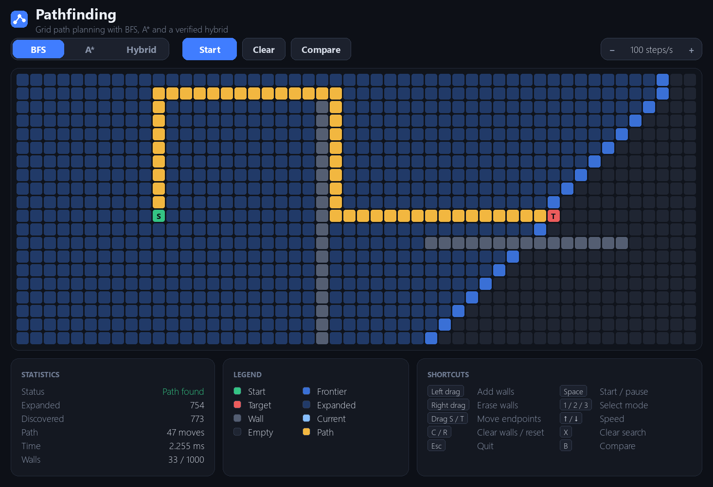
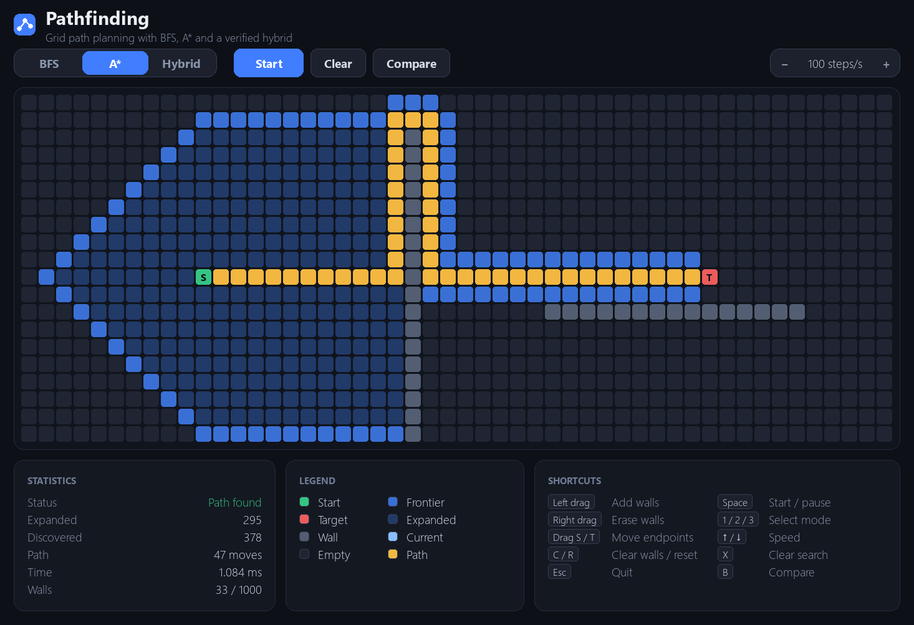
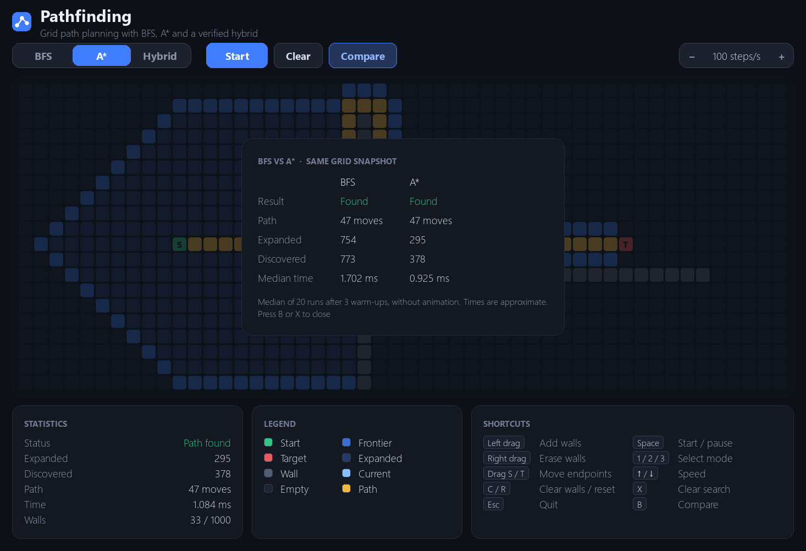
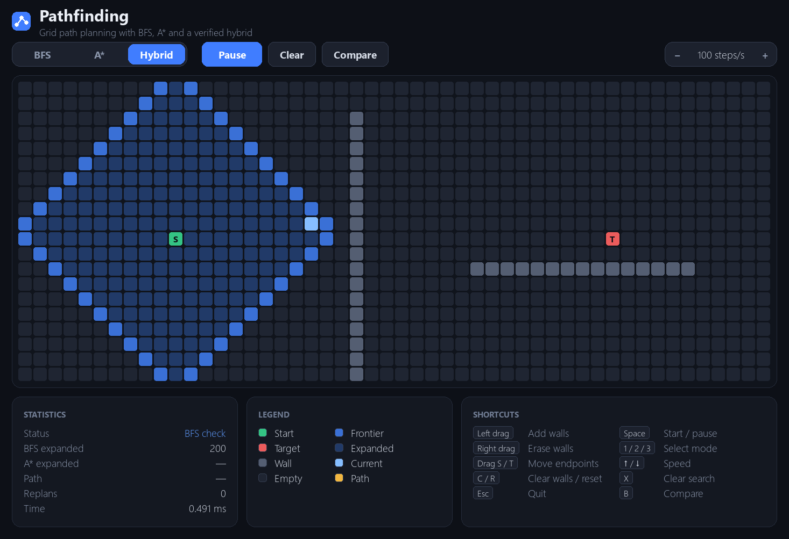
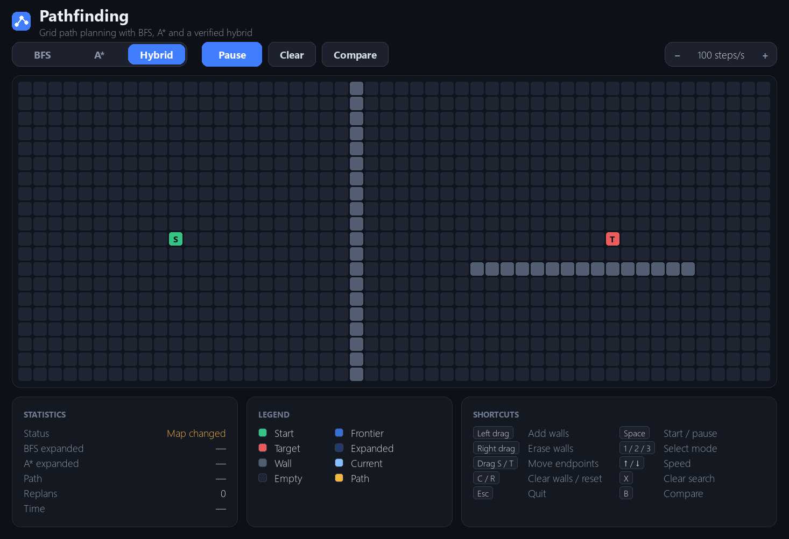
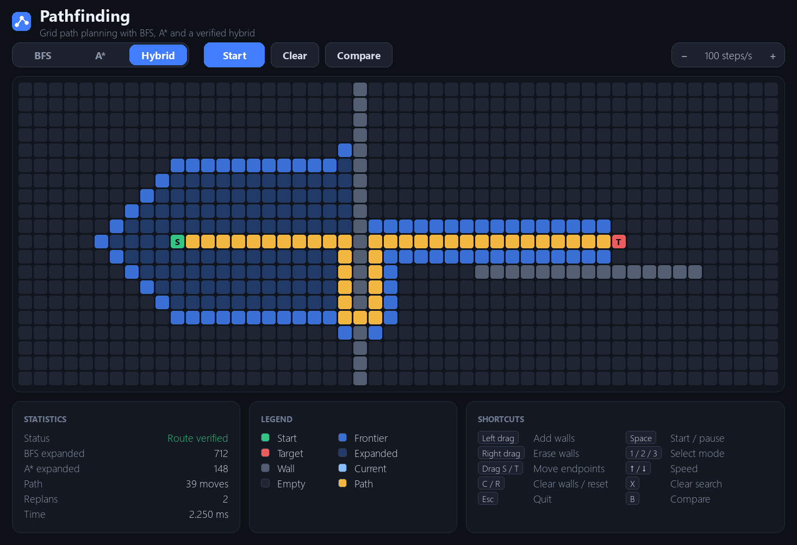

# Pathfinding

Python ve Pygame ile geliştirilmiş etkileşimli bir yol bulma (pathfinding) görselleştiricisi.
Izgara üzerine duvar çizebilir, başlangıç ve hedef noktalarını taşıyabilir, **BFS**, **A\*** ve
**doğrulamalı hibrit planlayıcının** yolu adım adım nasıl aradığını izleyebilirsiniz. Hibrit
planlayıcı, harita değiştiğinde rotayı kendiliğinden yeniden planlar.



## İçindekiler

- [Proje ne yapıyor?](#proje-ne-yapıyor)
- [Özellikler](#özellikler)
- [Kurulum ve çalıştırma](#kurulum-ve-çalıştırma)
- [Kullanım](#kullanım)
- [Algoritmalar](#algoritmalar)
- [Sonuçlar](#sonuçlar)
- [Ekran görüntüleri](#ekran-görüntüleri)
- [Proje yapısı](#proje-yapısı)
- [Testler](#testler)
- [Bilinen sınırlamalar](#bilinen-sınırlamalar)

## Proje ne yapıyor?

Uygulama 20 satır × 50 sütunluk bir ızgara üzerinde, başlangıç hücresinden (**S**) hedef
hücresine (**T**) duvarlardan geçmeden giden **en kısa yolu** bulur. Her hamle yukarı, aşağı,
sola veya sağa bir hücredir ve maliyeti 1'dir.

Arama ekranda adım adım canlandırılır. Hangi hücrelerin keşfedildiği, hangisinin o anda
işlendiği ve sonunda bulunan yol renklerle gösterilir. Gösterilen sıra, algoritmanın gerçekte
çalıştığı sıradır; arama sonradan uydurulmuş bir animasyon değildir.

Üç mod vardır:

| Mod        | Ne yapar?                                                                                           |
| ---------- | --------------------------------------------------------------------------------------------------- |
| **BFS**    | Genişlik öncelikli arama. Hücreleri başlangıca uzaklık sırasına göre, halka halka keşfeder.          |
| **A\***    | Manhattan uzaklığını sezgisel (heuristic) olarak kullanır ve aramayı hedefe doğru yönlendirir.       |
| **Hybrid** | Rotayı A\* ile planlar, BFS ile bağımsız olarak doğrular ve harita değişince yeniden planlar.        |

## Özellikler

- **Etkileşimli ızgara düzenleyici:** Fareyle duvar ekleme ve silme, başlangıç ve hedefi sürükleyerek taşıma
- **Adım adım animasyon:** Keşfedilen, işlenen ve yol hücreleri ayrı renklerle gösterilir; bulunan yol başlangıçtan hedefe doğru sırayla belirir
- **Arama kontrolleri:** Başlat, duraklat, devam et, aramayı temizle; animasyon hızı saniyede 1 ile 1000 adım arasında ayarlanabilir
- **Doğrulamalı hibrit planlama:** A\* rotası, BFS'in bulduğu en kısa mesafeyle karşılaştırılır; uyuşmayan rota kabul edilmez
- **Dinamik yeniden planlama:** Hibrit modda harita değiştiğinde eski rota hemen gizlenir, düzenlemeler bitince rota yeniden hesaplanır
- **Algoritma karşılaştırması:** BFS ve A\* aynı haritanın kopyası üzerinde, animasyonsuz olarak karşılaştırılır
- **Canlı istatistikler:** Durum, genişletilen ve keşfedilen hücre sayısı, yol uzunluğu, hesaplama süresi
- **Eski sonuç gösterilmez:** Haritadaki her değişiklik bir sürüm sayacıyla izlenir; eski haritaya ait bir sonuç asla yeni haritanın üzerinde çizilmez
- **Net görüntü:** Windows ekran ölçeklendirmesinde görüntü bulanıklaşmaz; pencere ekrana sığan en büyük boyutta açılır

## Kurulum ve çalıştırma

### Gereksinimler

- Python **3.11 – 3.13**
- Pygame **2.6.1** (`requirements.txt` içinde sabitlenmiştir)

Pygame 2.6.1'in Python 3.14 için hazır paketi bulunmadığından Python 3.13 veya daha eski bir
sürüm kullanın. Proje Windows 11 üzerinde Python 3.13 ile geliştirilip test edilmiştir.

### Windows (PowerShell)

```powershell
git clone https://github.com/<kullanici-adi>/pathfinding.git
cd pathfinding
python -m venv .venv
.venv\Scripts\Activate.ps1
pip install -r requirements.txt
python main.py
```

PowerShell betik çalıştırma politikası nedeniyle `Activate.ps1` engellenirse sanal ortamı
etkinleştirmeden doğrudan şu komutları kullanabilirsiniz:

```powershell
.venv\Scripts\python -m pip install -r requirements.txt
.venv\Scripts\python main.py
```

### macOS / Linux

```bash
git clone https://github.com/<kullanici-adi>/pathfinding.git
cd pathfinding
python3 -m venv .venv
source .venv/bin/activate
pip install -r requirements.txt
python main.py
```

## Kullanım

### Araç çubuğu

Izgaranın üzerindeki araç çubuğu, aramayla ilgili bütün işlemleri düğme olarak sunar:

| Düğme                     | İşlev                                                                  |
| ------------------------- | ---------------------------------------------------------------------- |
| **BFS / A\* / Hybrid**    | Arama modunu seçer. Seçili mod mavi renkle vurgulanır.                  |
| **Start / Pause / Resume** | Aramayı başlatır, duraklatır veya kaldığı yerden devam ettirir.         |
| **Clear**                 | Aramayı ve karşılaştırma kartını temizler. Duvarlar korunur.            |
| **Compare**               | BFS ile A\* karşılaştırmasını açar veya kapatır.                        |
| **− / +**                 | Animasyon hızını azaltır veya artırır.                                  |

O anda bir etkisi olmayacak düğmeler soluk gösterilir; örneğin temizlenecek bir arama yokken
**Clear** düğmesi.

### Fare ve klavye

| Girdi                          | İşlev                                              |
| ------------------------------ | -------------------------------------------------- |
| Sol tık / sürükle              | Duvar ekler                                        |
| Sağ tık / sürükle              | Duvar siler                                        |
| **S** veya **T** üzerinde sol sürükleme | Başlangıcı veya hedefi taşır              |
| `Space`                        | Başlat / duraklat / devam et                       |
| `1` / `2` / `3`                | BFS / A\* / Hybrid modunu seçer                    |
| `↑` / `↓` (veya `+` / `-`)     | Animasyonu hızlandırır / yavaşlatır                |
| `X`                            | Aramayı ve karşılaştırmayı temizler                |
| `B`                            | Karşılaştırmayı açar / kapatır                     |
| `C`                            | Bütün duvarları siler                              |
| `R`                            | Duvarları siler, başlangıç ve hedefi varsayılan yerlerine döndürür |
| `Esc` veya pencereyi kapatma   | Uygulamadan çıkar                                  |

Başlangıç ve hedef yalnızca boş hücrelere bırakılabilir. Harita düzenlemesinin etkisi moda göre
değişir:

| Mod       | Arama sürerken, duraklatılmışken veya bittikten sonra harita düzenlenirse                       |
| --------- | ------------------------------------------------------------------------------------------------ |
| BFS / A\* | Arama iptal edilir ve durum *Ready* olur. Yeni harita için `Space` ile tekrar başlatılır.          |
| Hybrid    | Eski rota hemen gizlenir ve planlayıcı **kendiliğinden yeniden planlar**.                          |

Hiçbir modda `Space`'e basmadan yapılan düzenlemeler arama başlatmaz. Mod değiştirmek mevcut
aramayı iptal eder; yeni mod `Space` ile başlatılır.

### Renkler

| Renk          | Anlamı                                                       |
| ------------- | ------------------------------------------------------------ |
| Yeşil **S**   | Başlangıç                                                    |
| Kırmızı **T** | Hedef                                                        |
| Gri           | Duvar                                                        |
| Koyu gri      | Boş, henüz ulaşılmamış hücre                                 |
| Mavi          | Sınır (frontier): keşfedilmiş, kuyrukta işlenmeyi bekliyor   |
| Koyu mavi     | Genişletilmiş: kuyruktan çıkarılmış, komşuları incelenmiş    |
| Açık mavi     | Son adımda işlenen hücre                                     |
| Turuncu       | Bulunan en kısa yol                                          |

### İstatistik kartı

İlk satır (**Status**) aramanın durumunu kısa ve renkli olarak gösterir: *Ready*, *Searching*,
*Paused*, *Path found*, *No path*. Hibrit modda çalışan aşama da yazılır: *BFS check*,
*A\* planning*, *Map changed*, *Route verified*, *Verification failed*.

| Alan           | Tanım                                                                      |
| -------------- | -------------------------------------------------------------------------- |
| Expanded       | Kuyruktan çıkarılıp komşuları incelenen farklı hücre sayısı                 |
| Discovered     | Başlangıç dahil, en az bir kez ulaşılan farklı hücre sayısı                 |
| Path           | Yoldaki **hamle** sayısı (hücre sayısı − 1) ya da *No path*                 |
| Time           | Yalnızca arama kodunun içinde geçen süre                                    |
| Walls          | Duvar sayısı (BFS ve A\* modlarında)                                        |
| BFS / A\* expanded | Hibrit modda iki aşamanın ayrı ayrı genişlettiği hücre sayısı          |
| Replans        | Bu hibrit oturumda harita değişikliği nedeniyle başlatılan yeniden plan sayısı |

Her iki algoritmada da hedef hücresi *keşfedilmiş* sayılır ama *genişletilmiş* sayılmaz, çünkü
komşuları hiç incelenmez. Böylece iki algoritmanın sayıları birbiriyle karşılaştırılabilir.

## Algoritmalar

Bütün modlar dört yönlü hareket kullanır ve her hamlenin maliyeti 1'dir. Komşular her zaman
aynı sırayla üretilir: **yukarı, aşağı, sol, sağ** (`core/grid.py` içindeki `NEIGHBOR_OFFSETS`).
Bu sayede aynı harita her çalıştırmada aynı sonucu verir.

Algoritmalar *generator* olarak yazılmıştır: her genişletilen hücre için bir `Expansion` olayı
üretirler (`algorithms/common.py`). Arayüz yalnızca bu olayları çizer; bu nedenle ekranda
görülen sıra, aramanın gerçek sırasıdır. Algoritmalar Pygame'e bağımlı değildir ve arayüz
olmadan da kullanılabilir.

### BFS (`algorithms/bfs.py`)

BFS hücreleri keşfedildikleri sırayla işler ve bunun için bir FIFO kuyruğu
(`collections.deque`) kullanır. Her hücreye ilk kez en kısa yoldan ulaşıldığı için, bütün
hamlelerin maliyeti eşit olduğunda BFS en kısa yolu bulur.

- `visited`: Kuyruğa eklenmiş her hücreyi tutar; böylece hiçbir hücre iki kez kuyruğa girmez.
- `parent`: Her hücrenin hangi hücreden keşfedildiğini tutar. Yol, hedeften başlayıp bu
  bağlantılar geriye doğru izlenerek oluşturulur.
- BFS hedef **keşfedildiği anda** durur. Bu kısayol yalnızca BFS için geçerlidir, çünkü BFS'te
  bir hücre ilk keşfedildiğinde zaten en kısa mesafesindedir.

### A\* (`algorithms/astar.py`)

A\* her adımda en düşük **f(n) = g(n) + h(n)** değerine sahip hücreyi işler:

- `g(n)`: Başlangıçtan o hücreye kadar bilinen maliyet
- `h(n)`: O hücreden hedefe Manhattan uzaklığı, yani `|Δsatır| + |Δsütun|`

Manhattan uzaklığı bu ızgarada kalan maliyeti hiçbir zaman olduğundan fazla tahmin etmez
(*admissible*) ve bir hamlede en fazla 1 değişir (*consistent*). Bu yüzden A\* en kısa yolu
bulur ve hiçbir hücreyi iki kez genişletmez.

- Bekleyen hücreler bir öncelik kuyruğunda (`heapq`) tutulur; en düşük `f` değerli hücreyi
  almak O(log n) sürer.
- Eşitlikler belirli bir kurala göre bozulur: önce en düşük `f`, sonra en düşük `h`, sonra
  kuyruğa eklenme sırası.
- Kuyruktaki bir hücreye daha kısa bir yol bulunursa hücre kuyruğa yeniden eklenir. Eski kayıt
  kuyruktan çıktığında, hücre zaten işlenmiş olduğu için atlanır. Bu hücreler yeni keşif olarak
  sayılmaz.
- A\* hedef kuyruktan **çıkarıldığında** durur. Hedef keşfedildiği anda durmak A\* için en kısa
  yolu garanti etmez.

### Hybrid: doğrulamalı planlama (`core/hybrid.py`)

**Amaç:** Kullanıcıya gösterilen rotanın bağımsız olarak doğrulanmış olması. Bu yaklaşım, bir
planlayıcının çıktısını ayrı bir güvenlik denetleyicisinin kontrol etmesine benzer. A\* rotayı
planlar; BFS ise hedefe ulaşılıp ulaşılamayacağını ve gerçek en kısa mesafeyi bağımsız olarak
hesaplar. Hibrit mod tek başına A\*'tan **daha fazla iş yapar**; değeri hızda değil, sonucun iki
ayrı algoritmayla doğrulanmasındadır.

Her plan haritanın donmuş bir kopyası (`Grid.copy()`) üzerinde çalışır ve şu adımlardan oluşur:

1. **BFS kontrolü:** BFS sonuna kadar çalışır. Hedefe ulaşılamıyorsa sonuç *No path* olur ve
   A\* hiç çalıştırılmaz. Olmayan bir rota uydurulmaz.
2. **A\* planlaması:** A\* aynı kopya üzerinde rotayı planlar.
3. **Doğrulama:** A\* rotası ancak başlangıçta başlıyor, hedefte bitiyor, yalnızca geçilebilir
   komşu hücrelerden geçiyor **ve** uzunluğu BFS mesafesine eşitse kabul edilir. Aksi halde
   durum *Verification failed* olur ve rota çizilmez. Doğru çalışan kodla bu durum oluşmaz;
   testler hatalı bir planlayıcıyı taklit ederek kontrolün çalıştığını doğrular.

BFS ve A\* `yield from` ile olduğu gibi yeniden kullanılır; `hybrid_steps` içinde iki
algoritmanın kodu kopyalanmamıştır. Aşamalar arasında ekran temizlenir, böylece iki aramanın
izleri birbirine karışmaz.

**Ne değildir?** Bu yöntem D\* Lite, LPA\* gibi *artımlı* (incremental) bir arama değildir: her
plan sıfırdan yapılır ve önceki aramanın sonuçlarını yeniden kullanmaz. Araç kinematiğini hesaba
katan *Hybrid A\** algoritması da değildir. Buradaki "hibrit" kelimesi, *birlikte çalışan iki
algoritma* anlamına gelir.

### Dinamik yeniden planlama (`core/pathfinder.py`)

Hibrit oturum `Space` ile başlatıldıktan sonra her karede haritanın sürüm sayacı
(`Grid.revision`) kontrol edilir:

1. **Değişiklik algılanır:** Düzenleme sonucu değiştirebilecek türdense, çalışan planın
   generator'ı kapatılır, eski rota ve arama izleri hemen gizlenir ve durum *Map changed* olur.
2. **Bekleme:** Planlayıcı, `REPLAN_SETTLE_SECONDS` (0,3 saniye) boyunca yeni bir düzenleme
   yapılmamasını bekler. Her yeni düzenleme bu süreyi baştan başlatır. Böylece fareyle 20
   hücrelik bir çizgi çizmek 20 değil, **tek** bir yeniden plana yol açar.
3. **Yeniden plan:** Haritanın güncel kopyası üzerinde BFS kontrolü ve A\* planlaması yeniden
   çalışır; *Replans* sayacı bir artar.

**İlgisiz düzenlemeler için kural:** Tamamlanmış bir sonuç, düzenleme yalnızca *duvar
eklediyse*, eklenen duvarların hiçbiri rotanın üzerinde değilse ve başlangıç ile hedef yerinde
duruyorsa yeniden planlama yapılmadan **korunur**. Duvar eklemek hiçbir yolu kısaltamaz; bu
nedenle korunan rota hem geçerli hem de hâlâ en kısadır. Ulaşılamayan bir hedef de ulaşılamaz
kalır. Duvar silmek veya başlangıcı / hedefi taşımak daha kısa bir yol açabileceği için her
zaman yeniden plana yol açar.

Diğer kurallar:

- Oturum duraklatılmışken yapılan düzenlemelerde eski rota yine hemen gizlenir, ancak yeniden
  plan oturuma devam edildiğinde başlar (durum: *Replan pending*).
- `X` oturumu bitirir. `1` / `2` oturumu bitirip modu değiştirir. `R` sıradan bir düzenleme
  sayılır ve yeniden plana yol açar.
- Aynı anda en fazla bir arama generator'ı vardır; yenisi oluşturulmadan önce eskisi kapatılır.

### Animasyon ve arayüzün donmaması

Ana döngü her karede yalnızca seçilen hıza karşılık gelen sayıda arama adımı çalıştırır. Arama
hiçbir zaman tek bir karede sonuna kadar çalıştırılmaz ve `time.sleep` kullanılmaz; bu yüzden
arama sürerken de pencere fareye ve klavyeye anında tepki verir. Renk geçişleri ve yolun sırayla
belirmesi tamamen görseldir, aramayı yavaşlatmaz.

## Sonuçlar

Aşağıdaki ölçümler, ekran görüntülerindeki örnek haritada alınmıştır: başlangıç ile hedef
arasında üstte boşluk bırakan dikey bir duvar ve hedefin altında yatay bir duvar.

### BFS ve A\* karşılaştırması

| Metrik                     | BFS      | A\*      |
| -------------------------- | -------- | -------- |
| Sonuç                      | Yol bulundu | Yol bulundu |
| Yol uzunluğu               | 47 hamle | 47 hamle |
| Genişletilen hücre         | 754      | 295      |
| Keşfedilen hücre           | 773      | 378      |
| Medyan hesaplama süresi\*  | ≈ 1,7 ms | ≈ 0,9 ms |

\* `B` tuşuyla açılan karşılaştırmadan alınmıştır: her algoritma 3 kez ısınma amaçlı, ardından
20 kez dönüşümlü olarak çalıştırılmış ve medyan süre alınmıştır. Süreler yaklaşık değerlerdir
ve bilgisayara göre değişir; genişletilen ve keşfedilen hücre sayıları ise kesin ve her
çalıştırmada aynıdır.

**Yorum:** İki algoritma da aynı uzunlukta, en kısa yolu buldu. A\*, Manhattan uzaklığı
sayesinde aramayı hedefe yönlendirdiği için BFS'in yaklaşık %39'u kadar hücre genişletti.
Engelsiz bir ızgarada fark çok daha büyüktür: Manhattan uzaklığı orada tam doğru tahmin
verdiğinden A\* yalnızca yol üzerindeki hücreleri genişletir (testlerde doğrulanmıştır).

### Hibrit mod ve yeniden planlama

| Adım                                      | Sonuç                                                         |
| ----------------------------------------- | ------------------------------------------------------------- |
| İlk plan                                  | Rota doğrulandı: BFS 47, A\* 47 hamle (BFS 754, A\* 295 genişletme) |
| Üstteki boşluk duvarla kapatıldı           | Eski rota hemen gizlendi; 1. yeniden plan sonucu: *No path*   |
| Duvarın alt kısmında yeni bir boşluk açıldı | 2. yeniden plan: 39 hamlelik yeni rota doğrulandı (BFS 712, A\* 148 genişletme) |

Arama ve yeniden planlama sırasında ölçülen en uzun kare süresi yaklaşık 18–24 ms'dir; çizim tek
başına kare başına yaklaşık 4 ms sürer.

## Ekran görüntüleri

**A\*:** Aynı haritada A\*, aramayı hedefe doğru yönlendirir ve daha az hücre genişletir.



**Karşılaştırma:** BFS ve A\* aynı harita kopyası üzerinde, animasyonsuz olarak karşılaştırılır.



**Hibrit mod, BFS kontrolü:** Hibrit plan önce BFS ile ulaşılabilirliği ve en kısa mesafeyi
kontrol eder.



**Hibrit mod, doğrulanmış rota:** A\* rotası BFS mesafesiyle eşleşti ve kabul edildi.


**Harita değişti:** Boşluk kapatıldığında eski rota hemen gizlenir ve planlayıcı düzenlemelerin
bitmesini bekler.



**Yeniden planlanan rota:** Yeni açılan boşluktan geçen rota bulundu ve doğrulandı.



## Proje yapısı

```text
pathfinding/
├── main.py                 # Uygulama döngüsü, fare/klavye/düğme olayları
├── config.py               # Izgara boyutu, hız seviyeleri, yeniden planlama ve karşılaştırma ayarları
├── requirements.txt
├── algorithms/             # Saf Python, Pygame kullanmaz
│   ├── common.py           # Expansion / SearchResult tipleri, yolun geri oluşturulması
│   ├── bfs.py              # BFS generator'ı
│   ├── astar.py            # Manhattan sezgiselli A* generator'ı
│   └── registry.py         # Mod listesi (BFS, A*, Hybrid) ve algoritma eşlemesi
├── core/                   # Saf Python, Pygame kullanmaz
│   ├── grid.py             # Izgara modeli, komşu sırası, sürüm sayacı, copy()
│   ├── hybrid.py           # BFS kontrolü + A* planı + doğrulama; rotayı koruma kuralı
│   ├── pathfinder.py       # Durum makinesi, adım hızı, geçersiz kılma, yeniden planlama
│   └── benchmark.py        # Harita kopyası üzerinde BFS / A* karşılaştırması
├── ui/                     # Arayüz katmanı
│   ├── theme.py            # Renkler, fontlar, boşluklar, animasyon süreleri, ölçekleme
│   ├── controls.py         # Düğmeler, düğme durumları ve durum metinleri (Pygame kullanmaz)
│   ├── content.py          # Kart metinleri ve değer biçimlendirme (Pygame kullanmaz)
│   ├── animation.py        # Renk ve hover geçişleri (Pygame kullanmaz)
│   ├── layout.py           # Bütün dikdörtgenlerin hesaplanması
│   ├── widgets.py          # Kart, düğme, tuş etiketi ve logo çizimi
│   ├── display.py          # DPI farkındalığı, ekrana sığan ölçeğin seçimi
│   └── renderer.py         # Kareyi çizer; durumu okur, asla değiştirmez
├── docs/                   # Ekran görüntüleri
└── tests/                  # unittest test paketi
```

Tasarım kuralları:

- `algorithms/` ve `core/` Pygame'e bağımlı değildir; arayüz olmadan test edilebilir ve kullanılabilir.
- Arayüz yalnızca durumu gösterir. Bir tıklamanın ne anlama geldiğine `main.py`, ızgaranın neye
  izin verdiğine `core/grid.py` karar verir.
- Eski sonuçlar sürüm sayacıyla engellenir: her harita değişikliği `Grid.revision` değerini
  artırır. Arama ve karşılaştırma, hesaplandıkları sürümü saklar; sürüm değiştiğinde iptal edilir
  ya da (hibrit modda) yeniden planlanır.

### Görüntü ölçekleme

Windows'ta Pygame pencereleri varsayılan olarak DPI farkındalığına sahip değildir; ekran
ölçeklendirmesi %100'ün üzerindeyse işletim sistemi görüntüyü büyütür ve metin bulanıklaşır.
Uygulama açılışta kendini DPI farkındalığına sahip olarak tanımlar, ekranın kullanılabilir
alanını ölçer ve arayüzü (fontlar dahil) bu alana sığan en büyük ölçekte çizer. Küçük
ekranlarda arayüz otomatik olarak küçülür.

## Testler

Testleri çalıştırmak için:

```bash
python -m unittest discover -s tests -t .
```

Toplam **142 test** bulunur ve hepsi geçer.

| Dosya                        | Test | Kapsam                                                                                  |
| ---------------------------- | ---: | --------------------------------------------------------------------------------------- |
| `tests/test_grid.py`         | 13   | Izgara kuralları, komşu sırası, sürüm sayacı, harita kopyası                             |
| `tests/test_bfs.py`          | 11   | En kısa yol, engeller, ulaşılamayan hedef, FIFO sırası, belirlenimcilik                  |
| `tests/test_astar.py`        | 11   | En kısa yol, eski kuyruk kayıtları, tekrarsız genişletme, artmayan `f` sırası            |
| `tests/test_hybrid.py`       | 13   | Hibrit aşamalar, BFS / A\* uyumu, hatalı planın reddedilmesi, yoğun tam boy haritalar    |
| `tests/test_replanning.py`   | 17   | Duvar ve uç nokta düzenlemelerinde yeniden planlama, birleştirme, iptal, duraklatma      |
| `tests/test_benchmark.py`    | 4    | Karşılaştırma sonuçlarının doğruluğu, metrik tutarlılığı, harita kopyasının bağımsızlığı |
| `tests/test_pathfinder.py`   | 22   | Başlat / duraklat / devam, hız, mod değiştirme, art arda aramalar                        |
| `tests/test_app.py`          | 38   | Uygulamanın sentetik fare / klavye olaylarıyla sınanması, düğmeler, yerleşim             |
| `tests/test_animation.py`    | 9    | Renk ve hover geçişleri                                                                  |
| `tests/test_display.py`      | 4    | Ölçek seçimi ve büyük ölçekte fare–hücre eşlemesi                                         |

BFS, A\* ve hibrit mod, kuyruk kullanmayan bağımsız bir en kısa mesafe hesabıyla, sabit
tohumlu (seed) yüzlerce rastgele harita üzerinde karşılaştırılır. Arayüz testleri, Pygame'in
pencere açmayan `dummy` sürücüsüyle ve programdan üretilen olaylarla çalışır; fiziksel fare ve
klavye kullanılmaz.

## Bilinen sınırlamalar

- Yeniden planlama her seferinde sıfırdan yapılır; D\* Lite veya LPA\* gibi artımlı
  planlayıcıların yaptığı şekilde önceki aramanın sonuçları yeniden kullanılmaz.
- Yeniden planlar seçilen animasyon hızında çalışır; düşük hızda geniş ve açık bir haritada
  birkaç saniye sürebilir (`↑` ile hızlandırılabilir).
- Hareket eden bir araç yoktur: planlayıcı başlangıçtan hedefe kadar bütün rotayı yeniden
  hesaplar, rotayı takip etmez.
- Tek arazi türü duvardır; her hamlenin maliyeti 1'dir ve çapraz hareket desteklenmez.
- Karşılaştırma `B` tuşuna basıldığında eşzamanlı olarak çalışır (onlarca milisaniye). Süreler
  yaklaşık değerlerdir, titiz bir performans ölçümü değildir.
- Pencere boyutu açılışta belirlenir; çalışırken yeniden boyutlandırılamaz.
- Arayüz metinleri İngilizcedir.
